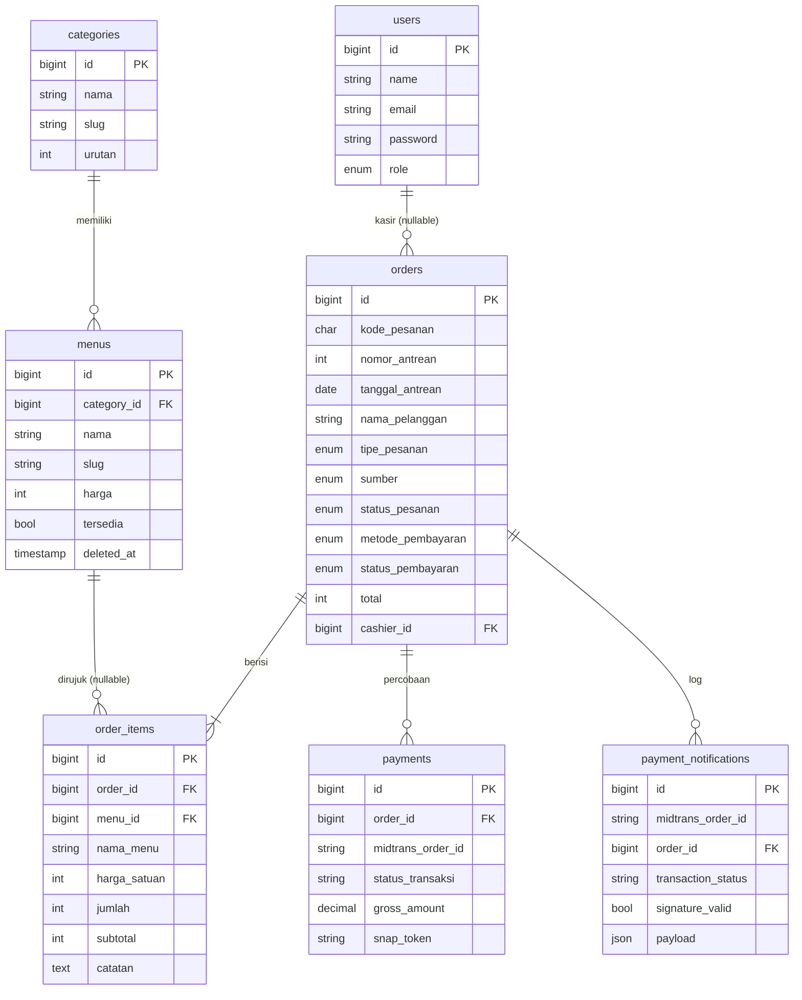

# Kontrak Database — Kedai Kopi Varya

**Status:** FINAL untuk skema inti
**Terakhir diperbarui:** 27 Oktober 2026
**Acuan:** `PRD.md` §10, `docs/DECISIONS.md`
**Database:** MySQL saja

> Dokumen ini memakai nama tabel dari PRD dan nama kolom bisnis bahasa Indonesia. Kolom teknis framework (`id`, `*_id`, `created_at`, `updated_at`, `deleted_at`) serta kolom mentah Midtrans tetap English.
>
> Jangan memakai `database/database.sqlite`. Jangan mengubah migration lama yang sudah dijalankan; buat migration baru untuk rename/tambah kolom.

---

## 1. Prinsip

- Satu sumber kebenaran data menu: tabel `menus`, bukan array di controller.
- Semua nominal Rupiah disimpan sebagai integer, kecuali `payments.gross_amount` yang mengikuti Midtrans (`decimal(15,2)`).
- Waktu memakai `Asia/Jakarta` (WIB).
- `order_items` menyimpan snapshot `nama_menu` dan `harga_satuan`.
- `menus` memakai soft delete; riwayat order tetap utuh.
- Semua foreign key diberi constraint dan index.
- Perubahan skema hanya lewat migration.
- Nomor antrean dan status pembayaran diproses dalam transaksi database.
- `order_items.catatan` menyimpan catatan per item (padanan `order_items.notes`).
- `orders.cashier_id` menyimpan kasir pembuat order tunai; `null` untuk order QRIS.
- Data menu kanonik berasal dari satu seeder; controller kasir/admin tidak boleh punya array menu sendiri.

---

## 2. Konvensi penamaan

| Bagian | Aturan | Contoh |
|---|---|---|
| Nama tabel | Mengikuti PRD, plural English | `orders`, `order_items` |
| Kolom bisnis | Bahasa Indonesia | `nama`, `harga`, `kode_pesanan`, `catatan` |
| Kolom teknis framework | English | `id`, `order_id`, `cashier_id`, `created_at`, `deleted_at` |
| Kolom akun Laravel | English | `users.name`, `email`, `password`, `role` |
| Enum domain | Bahasa Indonesia | `menunggu`, `lunas`, `antre`, `diproses` |
| Tipe pesanan | Mengikuti PRD | `dine_in`, `take_away` |
| Payload Midtrans | English | `transaction_status`, `status_code`, `gross_amount` |

Pengecualian ini disengaja agar tidak melawan konvensi Laravel dan API Midtrans.

---

## 3. Status

Tidak ada tabel pemetaan status. Nilai enum langsung memakai istilah PRD.

### 3.1 Status pembayaran (`orders.status_pembayaran`)

| Nilai | Arti |
|---|---|
| `menunggu` | Belum dibayar, transaksi masih aktif |
| `lunas` | Settlement/capture accept |
| `gagal` | Deny/cancel/failure |
| `kedaluwarsa` | Expire |
| `dibatalkan` | Dibatalkan sebelum bayar |
| `perlu_diperiksa` | Anomali, refund, chargeback |

### 3.2 Status pesanan (`orders.status_pesanan`)

| Nilai | Arti |
|---|---|
| `menunggu_pembayaran` | Order dibuat, belum lunas |
| `antre` | Lunas, masuk antrean |
| `diproses` | Sedang disiapkan |
| `selesai` | Sudah diserahkan |
| `dibatalkan` | Dibatalkan sebelum bayar |

Tidak ada `siap_saji`.

### 3.3 Status pemrosesan notifikasi

`payment_notifications.status_pemrosesan`: `diterima`, `diproses`, `diabaikan`, `gagal`.

### 3.4 Pemetaan status Midtrans

| Midtrans | Aplikasi |
|---|---|
| `pending` | `menunggu` |
| `settlement` | `lunas` |
| `capture` + `fraud_status=accept` | `lunas` |
| `capture` + `fraud_status=challenge` | `perlu_diperiksa` |
| `deny`, `cancel`, `failure` | `gagal` |
| `expire` | `kedaluwarsa` |
| `refund`, `partial_refund`, `chargeback` | `perlu_diperiksa` |

---

## 4. Tabel

### 4.1 `users`

| Kolom | Tipe | Null | Default | Catatan |
|---|---|---|---|---|
| `id` | bigint unsigned | no | auto | PK |
| `name` | varchar(255) | no | — | Kolom bawaan Laravel |
| `email` | varchar(255) | no | — | Unik |
| `password` | varchar(255) | no | — | Hash |
| `role` | enum(`admin`,`kasir`) | no | — | Tambahan |
| `remember_token` | varchar(100) | yes | null | |
| `created_at` | timestamp | yes | null | |
| `updated_at` | timestamp | yes | null | |

Index: `email` unik, `role`.

### 4.2 `categories`

| Kolom | Tipe | Null | Default | Catatan |
|---|---|---|---|---|
| `id` | bigint unsigned | no | auto | PK |
| `nama` | varchar(255) | no | — | Nama kategori |
| `slug` | varchar(255) | no | — | Unik |
| `urutan` | unsigned int | no | 0 | Urutan tampil |
| `created_at` | timestamp | yes | null | |
| `updated_at` | timestamp | yes | null | |

Kategori final: **Kopi, Teh, Autentik, Makanan, Cemilan**. Tidak ada CRUD kategori.

### 4.3 `menus`

| Kolom | Tipe | Null | Default | Catatan |
|---|---|---|---|---|
| `id` | bigint unsigned | no | auto | PK |
| `category_id` | bigint unsigned | no | — | FK `categories.id`, `restrictOnDelete` |
| `nama` | varchar(255) | no | — | Nama menu |
| `slug` | varchar(255) | no | — | Unik; untuk URL detail |
| `harga` | unsigned int | no | — | Rupiah integer |
| `deskripsi` | text | yes | null | |
| `foto` | varchar(255) | yes | null | Path/URL gambar |
| `tersedia` | boolean | no | true | `false` = Habis |
| `urutan` | unsigned int | no | 0 | Urutan tampil |
| `deleted_at` | timestamp | yes | null | Soft delete |
| `created_at` | timestamp | yes | null | |
| `updated_at` | timestamp | yes | null | |

Index: `(category_id, tersedia)`, `slug` unik.

Catatan: `is_featured` tidak dipakai. Menu terlaris dihitung dari `order_items`.

### 4.4 `orders`

| Kolom | Tipe | Null | Default | Catatan |
|---|---|---|---|---|
| `id` | bigint unsigned | no | auto | PK |
| `kode_pesanan` | char(8) | no | — | Unik; 8 karakter acak |
| `nomor_antrean` | unsigned smallint | yes | null | Null sampai lunas |
| `tanggal_antrean` | date | yes | null | Tanggal nomor antrean |
| `nama_pelanggan` | varchar(100) | no | — | Wajib |
| `tipe_pesanan` | enum(`dine_in`,`take_away`) | no | — | |
| `catatan` | text | yes | null | Maks. 500 karakter (validasi app) |
| `sumber` | enum(`qr`,`kasir`) | no | — | |
| `status_pesanan` | enum(`menunggu_pembayaran`,`antre`,`diproses`,`selesai`,`dibatalkan`) | no | `menunggu_pembayaran` | |
| `metode_pembayaran` | enum(`qris`,`tunai`) | no | — | |
| `status_pembayaran` | enum(`menunggu`,`lunas`,`gagal`,`kedaluwarsa`,`dibatalkan`,`perlu_diperiksa`) | no | `menunggu` | |
| `total` | unsigned int | no | — | Jumlah subtotal item |
| `uang_diterima` | unsigned int | yes | null | Khusus tunai |
| `kembalian` | unsigned int | yes | null | Khusus tunai |
| `cashier_id` | bigint unsigned | yes | null | FK `users.id`, `nullOnDelete`; hanya order kasir |
| `waktu_lunas` | timestamp | yes | null | |
| `batas_waktu_pembayaran` | timestamp | yes | null | Khusus QRIS |
| `created_at` | timestamp | yes | null | |
| `updated_at` | timestamp | yes | null | |

Constraint dan index:

- `kode_pesanan` unik.
- `(tanggal_antrean, nomor_antrean)` unik.
- Index `(status_pembayaran, created_at)`.
- Index `(status_pesanan, created_at)`.
- Index `(cashier_id, created_at)`.

### 4.5 `order_items`

| Kolom | Tipe | Null | Default | Catatan |
|---|---|---|---|---|
| `id` | bigint unsigned | no | auto | PK |
| `order_id` | bigint unsigned | no | — | FK `orders.id`, `cascadeOnDelete` |
| `menu_id` | bigint unsigned | yes | null | FK `menus.id`, `nullOnDelete` |
| `nama_menu` | varchar(255) | no | — | Snapshot |
| `harga_satuan` | unsigned int | no | — | Snapshot |
| `jumlah` | unsigned smallint | no | — | |
| `subtotal` | unsigned int | no | — | `harga_satuan * jumlah` |
| `catatan` | text | yes | null | Catatan per item (padanan `notes`) |
| `created_at` | timestamp | yes | null | |
| `updated_at` | timestamp | yes | null | |

Index: `order_id`, `menu_id`.

### 4.6 `payments`

| Kolom | Tipe | Null | Default | Catatan |
|---|---|---|---|---|
| `id` | bigint unsigned | no | auto | PK |
| `order_id` | bigint unsigned | no | — | FK `orders.id`, `cascadeOnDelete` |
| `midtrans_order_id` | varchar(50) | no | — | Unik; `{kode_pesanan}-P{n}` |
| `transaction_id` | varchar(100) | yes | null | ID Midtrans |
| `status_transaksi` | varchar(50) | no | — | Status mentah Midtrans |
| `status_code` | varchar(10) | no | — | Kode status Midtrans |
| `fraud_status` | varchar(20) | yes | null | |
| `gross_amount` | decimal(15,2) | no | — | Nominal Midtrans |
| `payment_type` | varchar(50) | yes | null | `other_qris` |
| `snap_token` | varchar(255) | yes | null | |
| `snap_redirect_url` | text | yes | null | |
| `raw_response` | json | yes | null | |
| `waktu_dibuat` | timestamp | no | now | Waktu percobaan dibuat |
| `waktu_diproses` | timestamp | yes | null | |
| `created_at` | timestamp | yes | null | |
| `updated_at` | timestamp | yes | null | |

Index: `order_id`, `midtrans_order_id` unik.

### 4.7 `payment_notifications`

| Kolom | Tipe | Null | Default | Catatan |
|---|---|---|---|---|
| `id` | bigint unsigned | no | auto | PK |
| `midtrans_order_id` | varchar(50) | no | — | Index |
| `order_id` | bigint unsigned | yes | null | FK `orders.id`, `nullOnDelete` |
| `transaction_status` | varchar(50) | no | — | Payload mentah Midtrans |
| `status_code` | varchar(10) | no | — | |
| `gross_amount` | decimal(15,2) | no | — | |
| `signature_valid` | boolean | no | false | |
| `payload` | json | no | — | Payload mentah |
| `status_pemrosesan` | enum(`diterima`,`diproses`,`diabaikan`,`gagal`) | no | `diterima` | |
| `catatan` | text | yes | null | Alasan |
| `received_at` | timestamp | no | now | Waktu diterima |
| `processed_at` | timestamp | yes | null | |

Index: `midtrans_order_id`, `order_id`.

### 4.8 `queue_counters`

| Kolom | Tipe | Null | Default | Catatan |
|---|---|---|---|---|
| `id` | bigint unsigned | no | auto | PK |
| `tanggal` | date | no | — | Unik |
| `nomor_terakhir` | unsigned int | no | 0 | |
| `created_at` | timestamp | yes | null | |
| `updated_at` | timestamp | yes | null | |

### 4.9 `promos`

| Kolom | Tipe | Null | Default | Catatan |
|---|---|---|---|---|
| `id` | bigint unsigned | no | auto | PK |
| `judul` | varchar(255) | no | — | |
| `deskripsi` | text | yes | null | |
| `gambar` | varchar(255) | yes | null | |
| `urutan` | unsigned int | no | 0 | |
| `aktif` | boolean | no | true | |
| `mulai` | date | yes | null | |
| `berakhir` | date | yes | null | |
| `created_at` | timestamp | yes | null | |
| `updated_at` | timestamp | yes | null | |

Tidak ada `subtitle`/`badge_text`.

### 4.10 `store_settings`

Satu baris (`id = 1`).

| Kolom | Tipe | Null | Default | Catatan |
|---|---|---|---|---|
| `id` | bigint unsigned | no | auto | PK |
| `nama_toko` | varchar(255) | no | `Kedai Kopi Varya` | |
| `tagline` | varchar(255) | yes | null | |
| `sejarah` | text | yes | null | Sejarah/profil |
| `alamat` | text | yes | null | Alamat lengkap |
| `maps_url` | text | yes | null | |
| `maps_embed` | text | yes | null | |
| `telepon` | varchar(30) | yes | null | |
| `whatsapp` | varchar(30) | yes | null | |
| `instagram` | varchar(100) | yes | null | |
| `fasilitas` | text | yes | null | Simpan JSON string daftar fasilitas |
| `created_at` | timestamp | yes | null | |
| `updated_at` | timestamp | yes | null | |

Tidak ada `landmark`/`hours` JSON.

### 4.11 `store_hours`

| Kolom | Tipe | Null | Default | Catatan |
|---|---|---|---|---|
| `id` | bigint unsigned | no | auto | PK |
| `hari` | unsigned tinyint | no | — | 0 = Minggu, 6 = Sabtu; unik |
| `jam_buka` | time | yes | null | |
| `jam_tutup` | time | yes | null | |
| `tutup` | boolean | no | false | |
| `created_at` | timestamp | yes | null | |
| `updated_at` | timestamp | yes | null | |

Single-store; belum ada `store_setting_id`.

---

## 5. Relasi

- `users` 1—N `orders` (kasir pembuat, nullable; hanya order tunai).
- `categories` 1—N `menus`.
- `menus` 1—N `order_items` (nullable, snapshot tetap ada).
- `orders` 1—N `order_items`.
- `orders` 1—N `payments`.
- `orders` 1—N `payment_notifications`.
- `store_settings` dan `store_hours` berdiri sendiri untuk satu toko.

---

## 6. Constraint dan index penting

| Constraint | Tabel | Alasan |
|---|---|---|
| `kode_pesanan` unik | `orders` | Identitas publik |
| `(tanggal_antrean, nomor_antrean)` unik | `orders` | Cegah nomor antrean ganda |
| `midtrans_order_id` unik | `payments` | Cegah percobaan ganda |
| `slug` unik | `categories`, `menus` | URL dan identitas |
| `hari` unik | `store_hours` | Satu baris per hari |
| `(category_id, tersedia)` | `menus` | Filter menu |
| `(status_pembayaran, created_at)` | `orders` | Dashboard/laporan |
| `(status_pesanan, created_at)` | `orders` | Daftar pesanan kasir |
| `(cashier_id, created_at)` | `orders` | Laporan per kasir |
| `midtrans_order_id` | `payment_notifications` | Audit webhook |
| `order_id` | `order_items`, `payments` | Query relasi |

---

## 7. Aturan transaksi

### 7.1 Membuat order tunai

1. Mulai transaksi database.
2. Validasi ulang menu: ada, tidak soft-deleted, `tersedia = true`, harga sesuai.
3. Hitung total dari harga server, bukan dari browser.
4. Kunci `queue_counters` untuk `tanggal` hari ini.
5. Naikkan `nomor_terakhir`, simpan `nomor_antrean` dan `tanggal_antrean`.
6. Simpan `orders` (`metode_pembayaran = tunai`, `status_pembayaran = lunas`, `status_pesanan = antre`, `cashier_id = auth()->id()`, `waktu_lunas = now`) dan `order_items` beserta `catatan` per item.
7. Commit.

### 7.2 Webhook pembayaran lunas

1. Verifikasi signature dan nominal.
2. Mulai transaksi database.
3. Kunci baris `orders` dengan `lockForUpdate()`.
4. Jika sudah `lunas` dan `nomor_antrean` sudah ada, selesai (idempoten).
5. Set `status_pembayaran = lunas`, `waktu_lunas`, `status_pesanan = antre`.
6. Jika `nomor_antrean` kosong, kunci `queue_counters`, naikkan, simpan nomor.
7. Simpan log `payment_notifications`.
8. Commit.

### 7.3 Pembayaran ulang

1. Kunci order.
2. Cek percobaan aktif (`menunggu`) yang belum kedaluwarsa.
3. Jika ada, kembalikan `snap_redirect_url` yang sama.
4. Jika tidak ada dan percobaan terakhir `gagal`/`kedaluwarsa`, buat `payments` baru dengan `midtrans_order_id = {kode_pesanan}-P{n+1}`.
5. Commit.

### 7.4 Pembatalan order belum dibayar

1. Kunci order.
2. Pastikan `status_pembayaran` masih `menunggu`/`gagal`/`kedaluwarsa`.
3. Batalkan transaksi Midtrans bila masih aktif.
4. Set `status_pembayaran = dibatalkan`, `status_pesanan = dibatalkan`.
5. Jangan membuat nomor antrean.

---

## 8. ERD

---

## 9. Status migration dan data

| Area | Status | Catatan |
|---|---|---|
| Nama kolom | Selesai | `categories`, `menus`, `promos`, dan `store_settings` sudah memakai nama Indonesia. |
| `users.role` | Selesai | Enum `admin`/`kasir` sudah ada; dipakai middleware `role`. |
| Akun awal | Selesai | Seeder membuat akun admin dan kasir dengan password ter-hash. |
| `menus.deleted_at` | Selesai | Soft delete aktif. |
| `menus` FK kategori | Selesai | `restrictOnDelete`. |
| `menus.is_featured` | Selesai | Kolom dihapus. |
| `menus.sort_order` | Selesai | Menjadi `urutan`. |
| `categories.sort_order` | Selesai | Menjadi `urutan`. |
| `promos` | Selesai | Field Indonesia + `mulai`/`berakhir`; `subtitle`/`badge_text` dihapus. |
| `store_settings` | Selesai | Field PRD; `landmark`/`hours` JSON dihapus. |
| Jam toko | Selesai | Tabel `store_hours` berisi 7 baris. |
| `orders` | Belum | Belum dibuat; termasuk `cashier_id`. |
| `order_items` | Belum | Belum dibuat; termasuk snapshot dan `catatan`. |
| `payments` | Belum | Belum dibuat. |
| `payment_notifications` | Belum | Belum dibuat. |
| `queue_counters` | Belum | Belum dibuat. |
| Engine database | Selesai | MySQL saja; SQLite tidak dipakai. |
| Konfigurasi test | Selesai | `phpunit.xml` memakai MySQL `kedai_varya_test`. |
| Data menu | Selesai | 12 menu kanonik; admin dan kasir membaca database. |

---

## 10. Data kanonik

### 10.1 Kategori

| Urutan | Nama | Slug |
|---|---|---|
| 1 | Kopi | `kopi` |
| 2 | Teh | `teh` |
| 3 | Autentik | `autentik` |
| 4 | Makanan | `makanan` |
| 5 | Cemilan | `cemilan` |

### 10.2 Menu

Sumber kanonik: `database/seeders/PelangganASeeder.php`.

| No | Nama | Kategori | Harga | Tersedia |
|---|---|---|---|---|
| 1 | Varya Signature | Kopi | 22.000 | Ya |
| 2 | Americano Street | Kopi | 18.000 | Ya |
| 3 | Matcha Creamy | Teh | 24.000 | Ya |
| 4 | Sunset Mocktail | Autentik | 26.000 | Ya |
| 5 | Artisan Jasmine | Teh | 18.000 | Ya |
| 6 | Caramel Macchiato | Kopi | 25.000 | Ya |
| 7 | Roti Bakar Mix | Makanan | 20.000 | Ya |
| 8 | Truffle Fries | Makanan | 22.000 | Ya |
| 9 | Bowl Sambal Matah | Makanan | 28.000 | Ya |
| 10 | Almond Croissant | Cemilan | 26.000 | Ya |
| 11 | Dimsum Mentai | Makanan | 24.000 | Ya |
| 12 | Cold Brew Grit | Kopi | 30.000 | Tidak |

Catatan:

- `Matcha Creamy` sudah berada di kategori Teh pada seeder dan database.
- Admin dan kasir membaca 12 menu kanonik dari database; tidak ada lagi daftar 24 menu demo di controller. Menu baru ditambahkan lewat CRUD admin setelah backend selesai.
- PRD §2.1 menyebut menu terlaris Mie Ae, Vanilla Latte, dan Heejo. Daftar menu lengkap dan harga ketiganya belum ada di PRD; jangan mengarang harga. Tambahkan lewat admin jika datanya sudah pasti.

### 10.3 Data lain

- 1 akun admin dan 1 akun kasir. Kredensial dibuat lewat `DatabaseSeeder` dan password disimpan sebagai hash. Jangan menulis password akun di dokumentasi atau repository.
- 3 promosi aktif sesuai PRD (`judul`, `deskripsi`, `gambar`, `urutan`, `aktif`, `mulai`, `berakhir`).
- 1 baris `store_settings`.
- 7 baris `store_hours`.

Data demo order (menunggu, lunas, gagal, `perlu_diperiksa`) belum ada karena tabel order belum dibuat. Saat backend tersedia, data demo hanya untuk local/testing melalui `DemoOrderSeeder` dan tidak dijalankan di produksi. Data demo tetap disimpan di database, bukan `localStorage`.

---

## 11. Urutan migration

1. Rename kolom `categories` dan `menus` ke bahasa Indonesia; rename `sort_order` menjadi `urutan`; hapus `is_featured`.
2. Tambah `users.role`.
3. Tambah `menus.deleted_at` dan ubah FK kategori menjadi `restrictOnDelete`.
4. Rename kolom `promos`; tambah `mulai`/`berakhir`; hapus `subtitle`/`badge_text`.
5. Rename kolom `store_settings`; tambah `maps_embed`, `telepon`, `whatsapp`, `fasilitas`; hapus `landmark`/`hours`.
6. Buat `store_hours` dan migrasikan data jam dari JSON/controller.
7. Buat `queue_counters`.
8. Buat `orders`.
9. Buat `order_items`.
10. Buat `payments`.
11. Buat `payment_notifications`.
12. Tambah index/constraint yang belum dibuat.

Jangan mengubah migration lama yang sudah dijalankan; buat migration baru. Jika database hanya berisi data demo dan sudah disetujui, `migrate:fresh --seed` boleh dipakai; jika ada data nyata, gunakan migration rename.
